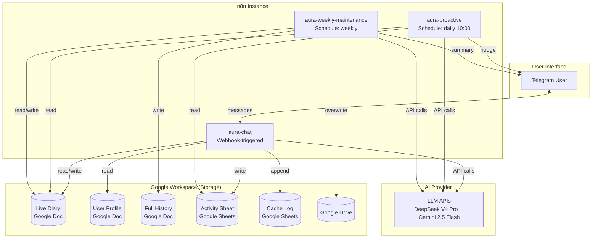
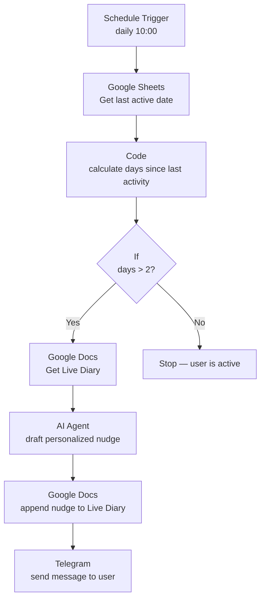
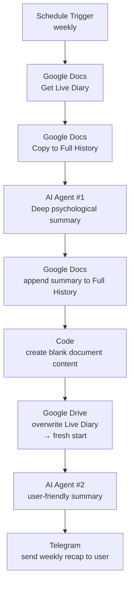

# Architecture — Aura AI Coach

## System Overview

Aura is composed of **3 independent n8n workflows** that coordinate through shared Google documents. There is no central server or database — the documents themselves serve as the integration layer.



---

## Workflow 1: aura-chat (Main Chat)

**Trigger:** Telegram Webhook (incoming message)
**Status:** Always active

### Node-by-node flow

```mermaid
flowchart TD
    A[Telegram Trigger<br/>message received] --> B{Switch<br/>message type?}
    
    B -->|photo| C[Gemini Vision<br/>Analyze image]
    C --> D[Edit Fields<br/>caption + image description]
    D --> J[Merge]
    
    B -->|voice| E[HTTP Request<br/>getFile API]
    E --> F[HTTP Request<br/>download file]
    F --> G[Code<br/>set MIME type]
    G --> H[Gemini<br/>Transcribe audio]
    H --> I[Edit Fields<br/>transcription text]
    I --> J
    
    B -->|text / fallback| J
    
    J --> K[Update Document<br/>append user message to Live Diary]
    K --> L[Get Document<br/>Live Diary]
    L --> M[Get Document<br/>User Profile]
    M --> N[AI Agent<br/>DeepSeek HTTP Request]
    N --> NX{Empty response?}
    NX -->|no| O[Cache Log<br/>token usage → Sheets]
    NX -->|yes| NY[Retry (max 2×)<br/>Attempt count → Attempt limit]
    NY -.->|retry| M
    NY -->|still empty| NZ[Fallback notice<br/>Telegram warning]
    O --> P[Send Telegram Message<br/>reply to user]
    P --> Q[Update Document<br/>append Aura response to Live Diary]
    Q --> R[Update Row in Sheet<br/>last active timestamp]
```

### Key details

| Node | Purpose | Notes |
|---|---|---|
| **Switch** | Routes by message type | Photo (file_id not empty) → vision branch; Voice (file_id not empty) → transcription branch; Text → fallback |
| **Gemini Vision** | Image analysis | Prompt: "You are my eyes..." — describes image content in detail |
| **HTTP Request chain** | Voice message download | Calls Telegram `getFile` API, then downloads the `.oga` file |
| **Code (MIME fix)** | Fixes audio MIME type | Telegram sends voice as `audio/ogg`; explicitly sets before sending to Gemini |
| **Gemini Transcribe** | Speech-to-text | Uses Gemini's multimodal capability (no separate Whisper API needed) |
| **Merge** | Combines all input paths | 3 inputs: image+caption, transcribed voice, plain text |
| **AI Agent** | Core LLM call | Direct HTTP request to the DeepSeek API (`/chat/completions`) with full system prompt + diary + profile + user message. Reply is read from `choices[0].message.content` |
| **Cache Log** | Token usage tracking | Records timestamp, model, tokens, and cache hit/miss to Google Sheets |
| **Activity Sheet** | Last active date | Updates a row so the proactive workflow knows when the user last interacted |

### Model & empty-response resilience

The core chat call is a plain HTTP request to the **DeepSeek API** (`deepseek-v4-pro`). The reply is validated before it goes anywhere else:

- **`Empty response check`** (If) — passes when `choices[0].message.content` is non-empty
- **`Attempt count` / `Attempt limit`** — on an empty reply the workflow loops back and retries the model call (up to 2 extra attempts)
- **`Fallback notice`** — if all 3 attempts come back empty, a Telegram warning is sent instead of failing silently

The validation expression:

```javascript
(($json.choices?.[0]?.message?.content ?? '').toString().trim())
```

---

## Workflow 2: aura-proactive (Daily Check-in)

**Trigger:** Schedule (daily at 10:00)
**Status:** Active, scheduled

### Node-by-node flow



### Key details

| Node | Purpose | Notes |
|---|---|---|
| **Schedule** | Daily trigger | Runs every day at 10:00 (configurable) |
| **Get last active** | Activity check | Reads the "Last active date" from the Activity Sheet |
| **Code** | Day calculation | Computes `(now - lastActive) / (1000 * 60 * 60 * 24)`. Handles empty cells (never active → force trigger) |
| **If** | Threshold gate | Only proceeds if `differenceInDays > 2` |
| **AI Agent** | Nudge generation | Reads the Live Diary, identifies the most relevant unresolved topic, drafts a 2-3 sentence check-in |
| **Telegram** | Delivery | Sends the drafted message to the user's chat ID |

### Nudge philosophy

The proactive prompt is carefully designed to:
- **Never guilt-trip** (no "You haven't written in a while")
- **Be specific** (references an actual topic from the last conversation)
- **Stay casual** (friendly, not clinical)

---

## Workflow 3: aura-weekly-maintenance (Weekly Summary)

**Trigger:** Schedule (weekly)
**Status:** Active, scheduled

### Node-by-node flow



### Key details

| Node | Purpose | Notes |
|---|---|---|
| **Copy to Full History** | Archive | Appends the raw diary to a separate "full history" doc before processing |
| **AI Agent #1** | Deep summary | Creates a detailed psychological narrative (20-30% of original volume). 3rd person, analytical, preserves key metaphors and emotional patterns |
| **Code** | Fresh document | Creates a minimal Google Doc content blob (`-`) to reset the diary |
| **Google Drive** | Overwrite diary | Uses Drive API to replace the Live Diary content, effectively wiping it for the new week |
| **AI Agent #2** | User summary | Creates a friendly, concise Telegram message highlighting key themes, wins, and next steps |
| **Telegram** | Delivery | Sends the user-friendly summary to the chat |

### Why two AI passes?

1. **Pass 1 (Deep summary):** Detailed, therapeutic-grade narrative for long-term memory. Too long and clinical for a Telegram message.
2. **Pass 2 (User summary):** Friendly, concise, formatted for Telegram (plain text, bold via `<b>` tags). Designed to be read in 2-3 minutes.

### Why weekly rotation? (Token economics)

The core purpose of the weekly maintenance workflow is **cost control**. Without it:

- The Master Diary would grow by ~2,000-5,000 tokens per day
- After one month, every API call would include ~60,000-150,000 tokens of history
- With a large static context, every call would consume 10-20x more input tokens than necessary
- After 6 months, the diary alone would dominate API costs

The rotation strategy keeps per-message token counts **flat and predictable** regardless of how long Aura has been running.

---

## Cost Efficiency & Context Caching

Aura's prompt architecture is designed to work with **DeepSeek's automatic prefix caching**, which gives a ~10× discount on cached input tokens. The cache persists for hours, so follow-up messages in a session usually hit it.

### How caching works (and when it doesn't)

The DeepSeek prefix cache keeps recent prompt prefixes for **hours**, so follow-up messages in a session usually hit it. This means:

- Back-to-back exchanges measured at **~98% cache-hit rate** on a ~277k-token context
- After a longer pause, the first message re-processes the full context at standard input pricing
- The Cache Log sheet exists specifically to monitor this: it tracks `HIT / MISS` on every API call, giving real visibility into caching behavior

**Prompt structure (designed for cache potential):**

```
┌──────────────────────────────────┐
│ SYSTEM INSTRUCTION (persona,     │
│ rules, tone, protocol)           │  ← STATIC → cached after the first call
├──────────────────────────────────┤
│ USER PROFILE (goals, patterns)   │  ← RARELY CHANGES → cached
├──────────────────────────────────┤
│ MASTER DIARY (conversation log)  │  ← GROWS BY APPENDING → previous content
│                                  │     stays cached; only new lines pay full price
├──────────────────────────────────┤
│ LATEST USER MESSAGE              │  ← NEW → full price (small)
└──────────────────────────────────┘
OUTPUT: Aura's response (~200-500 tokens, standard output pricing)
```

**Key design decisions:**

1. **System prompt comes first** — When caching does activate (rapid exchanges), the longest static content is at the start, maximizing the cacheable prefix
2. **User profile is stable** — written once, rarely edited
3. **Master Diary is the only growing element** — and it's reset weekly to prevent unbounded token growth
4. **Cache hit/miss is tracked** — the Cache Log Google Sheet records every API call, so you can see exactly when caching helps and when it doesn't

> 💡 **Reality check:** Measured on this setup: ~98% of input tokens are served from cache — the first message after a long pause re-processes everything. Caching does the heavy lifting; the weekly diary rotation keeps the total context (and the cost of a cache miss) from growing unbounded.

### Real-world costs

Costs depend heavily on language, message length, and conversation frequency. Czech (and other non-English languages) typically consume **1.5–2x more tokens** per message than English. Measured on this setup (Czech, ~277k-token context, ~98% served from cache):

| Usage pattern | Est. monthly cost | Real-world example |
|---|---|---|
| Light (a few messages/day) | **$1–3** (~25–70 CZK) | Quick check-ins, short reflections |
| Moderate (active daily use) | **$4–8** (~90–185 CZK) | Regular therapeutic conversations, voice messages, image analysis |
| Heavy (multiple long sessions/day) | **$10–15** (~230–345 CZK) | Deep sessions, multi-modal input, growing diary before rotation |

Factors that increase cost:
- **Language** — Czech/German/Slavic languages use more tokens than English
- **Voice messages** — audio transcription adds tokens
- **Image analysis** — vision API calls cost extra
- **Output length** — output tokens are priced ~20× higher than cached input tokens
- **Diary growth** — end-of-week messages cost more than Monday messages (before rotation)

---

## Data Model

### Google Docs

| Document | Purpose | Read by | Written by |
|---|---|---|---|
| **Live Diary** | Recent conversation history (current week) | All workflows | aura-chat, aura-proactive, aura-weekly |
| **User Profile** | Persistent user facts & preferences | aura-chat | (manual setup) |
| **Full History** | Long-term archive of all summaries | (future reference) | aura-weekly |

### Google Sheets

| Sheet | Columns | Purpose |
|---|---|---|
| **Activity Sheet** | `Last active date`, `row_number` | Tracks when the user last interacted. Checked daily by proactive workflow. |
| **Cache Log** | `Timestamp`, `Model`, `Total Tokens`, `Cached tokens`, `HIT / MISS` | API usage analytics. Tracks context-caching efficiency. |

---

## Error Handling & Resilience

- **Telegram send failures:** The `Send a text message` nodes have `onError: continueRegularOutput` — if a message fails to send (e.g., user blocked the bot), the workflow continues without breaking.
- **Retry on fail:** Critical nodes have `retryOnFail: true` enabled.
- **Empty model responses:** The chat workflow validates every reply (`Empty response check`). On an empty response it retries up to 2 more times (`Attempt count` → `Attempt limit`), then sends a Telegram fallback notice instead of failing silently.
- **Google Docs "Copy history" node:** Uses `onError: continueRegularOutput` to prevent the weekly maintenance from failing if the copy step encounters an issue.
- **No dead letter queue:** As a personal bot, failed interactions are visible in n8n's execution log for manual review.

---

## Security

- **Credentials:** All API keys, OAuth tokens, and the Telegram bot token are stored in n8n's encrypted credential store. They are **never exported** in workflow JSONs.
- **No external access:** All documents and sheets are in the user's personal Google Drive. No data leaves the user's Google account, except the LLM API calls (DeepSeek for chat, Google Gemini for vision & transcription).
- **Chat ID scoping:** The Telegram chat ID is hardcoded in the workflow, preventing other users from interacting with the bot.
- **Bot token in HTTP URLs:** Two `HTTP Request` nodes for Telegram file download include the bot token in the URL. These are replaced with `YOUR_BOT_TOKEN` in the public repository.

---

## Scaling Considerations

This architecture works well for a **single user**. For multi-user scenarios:

- Replace Google Docs with a proper database (PostgreSQL, MongoDB)
- Add user authentication and session management
- Replace hardcoded chat IDs with a user lookup
- Consider message queuing for high throughput

The core workflow logic (message routing, AI integration, proactive scheduling) remains applicable.
